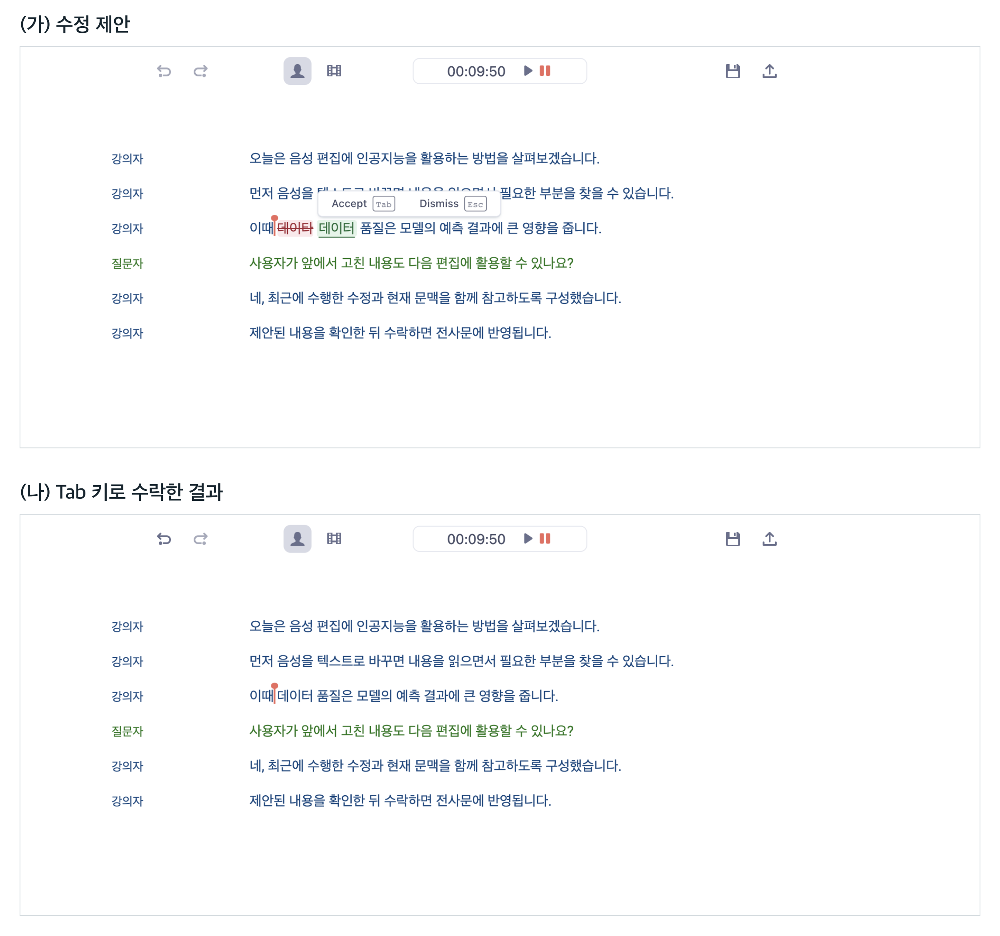

# Transcript Edit Copilot

**전사문과 최근 편집 이력을 바탕으로 다음 수정을 제안하는 음성·영상 편집기.**

[Audapolis](https://github.com/bugbakery/audapolis)를 기반으로, 강의·인터뷰·팟캐스트를 읽고 편집하는 흐름에 다음 편집 예측(Next Edit Prediction, NEP)을 더했습니다. 로컬 언어모델이 수정할 위치와 내용을 제안하고, 사용자가 확인한 변경만 적용합니다.



## 주요 기능

- **문맥을 반영한 제안** — 현재 전사문, 커서·선택 영역, 최근 편집과 이전 제안에 대한 반응을 함께 사용합니다.
- **전사·음성·자막 편집** — 문자 교정, 발화 삭제, 쉼 줄이기·없애기, 자막 분할·병합을 지원합니다. 수정이 필요하지 않으면 제안하지 않을 수 있습니다.
- **미리보기와 되돌리기** — 원문과 변경 내용을 비교한 뒤 수락하거나 거절합니다. 수락한 편집은 한 번에 되돌릴 수 있습니다.
- **한국어·영어 지원** — 다음 편집은 로컬에서 예측하며, 전사에는 ElevenLabs Scribe 또는 로컬 Vosk를 사용할 수 있습니다.

현재 연구용 프로토타입입니다. 모델의 제안이 항상 올바르지는 않으므로, 특히 발화 삭제와 쉼 조절은 앞뒤 음성을 확인하고 적용하세요.

## 빠른 시작

Node.js와 npm, Python 3.13 이상, uv가 필요합니다. 저장소 루트에서 실행합니다.

```sh
cd server
uv sync --locked
cd ../app
npm ci
npm start
```

앱을 실행하면 Python 서버도 함께 시작됩니다. 전사 제공자 설정과 로컬 모델 연결은 [서버 README](server/README.md)를 참고하세요. 모델 파일과 학습 데이터는 저장소에 포함하지 않습니다.

## 사용하기

1. 음성·영상을 불러와 전사하거나 저장된 프로젝트를 엽니다.
2. 로컬 모델을 연결한 경우 편집기의 **Local copilot**을 켭니다.
3. 제안을 확인하고 **Tab**으로 수락하거나 **Esc**로 거절합니다. 적용한 변경은 **Cmd/Ctrl+Z**로 되돌립니다.

쉼의 길이는 전사문 안의 초 단위를 눌러 직접 줄일 수 있습니다. 문서나 선택 영역이 바뀌면 이전 상태에서 만든 제안은 적용하지 않습니다.

## 프로젝트 구성

| 경로 | 역할 |
| --- | --- |
| [app/](app/README.md) | Electron·React 편집기, 인라인 제안, 편집 이력과 사용자 반응 |
| [server/](server/README.md) | FastAPI 서버, 전사, 로컬 모델 연결과 예측 검증 |
| [ml/](ml/) | 공통 편집 명세, 데이터 준비, 학습·평가·모델 변환 도구 |

설계 배경은 [제안서](docs/proposal.md), 저장 형식은 [문서 형식 명세](docs/fileformat_v3.md)에 정리되어 있습니다. 원본 미디어, 모델 가중치와 실험 결과는 로컬에서 별도로 관리합니다.

## 개발 및 검사

```sh
npm --prefix app run check
npm --prefix app run test:fast -- --runInBand
server/.venv/bin/python -m unittest discover -s server/tests
server/.venv/bin/python -m unittest discover -s ml
```

화면 검사는 [앱 README](app/README.md#검사)를 참고하세요. 선택적 라이브러리나 로컬 실험 자료가 필요한 검사는 해당 입력이 없으면 건너뜁니다.

## 라이선스

[GNU AGPL-3.0](LICENSE).
