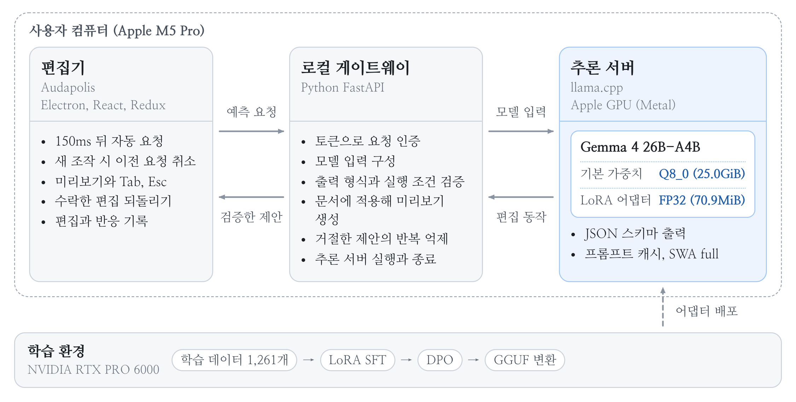

# 전사와 예측 서버

FastAPI 기반의 로컬 서버입니다. 전사 작업을 처리하고, 편집 상태를 로컬 언어모델에 전달한 뒤 제안의 대상, 형식, 문서 상태를 검증합니다.



## 실행

Python 3.13 이상과 uv가 필요합니다. `server/`에서 실행합니다.

```sh
uv sync --locked
uv run --locked python run.py
```

데스크톱 앱은 서버를 자동으로 실행하므로, 앱을 사용할 때에는 서버를 따로 켤 필요가 없습니다.

## 전사 설정

### ElevenLabs Scribe

앱을 실행할 터미널에 `ELEVENLABS_PERSONAL_API_KEY`를 설정한 뒤, 가져오기 화면에서 **ElevenLabs Scribe v2 (cloud)**를 선택합니다. 한국어, 영어, 자동 언어 감지를 지원합니다.

```sh
export ELEVENLABS_PERSONAL_API_KEY="your-api-key"
cd ../app
npm start
```

선택한 녹음이 ElevenLabs로 전송되며 API 사용 요금이 발생할 수 있습니다. 키는 저장소나 프로젝트 파일에 넣지 않습니다.

### 로컬 Vosk

`server/`에서 추가 의존성을 설치하고 앱의 모델 관리 화면에서 Vosk 모델을 내려받습니다.

```sh
uv sync --locked --extra local-asr
```

화자 분리에는 `HF_TOKEN`과 `pyannote/speaker-diarization-community-1` 모델 접근 권한도 필요합니다.

## 로컬 코파일럿

새로 내려받은 저장소에는 모델 가중치와 배포 설정이 없습니다. 편집기는 모델 없이도 열리지만 자동 제안은 사용할 수 없습니다. 일반 앱 실행은 `artifacts/local-runtime/gemma-actions-v3/default-deployment.json`이 가리키는 검증된 배포가 있을 때 `llama-server`를 시작합니다. 앱이 시작한 모델은 앱과 함께 종료됩니다.

연구의 최종 실행 구성은 Gemma 4 26B-A4B에 SFT와 DPO를 적용한 모델이며, Mac에서 Q8_0 기본 가중치와 FP32 LoRA를 llama.cpp b10816, SWA full 설정으로 실행했습니다. 기본 가중치 파일은 약 25.0GiB, 어댑터는 약 70.9MiB입니다. 실제 검증 기기는 메모리 48GiB의 Apple M5 Pro이며, 이보다 작은 메모리의 최소 사양을 측정한 것은 아닙니다.

### 모델과 배포 자료 준비

최종 모델의 자동 제안을 실행하려면 다음 자료가 별도로 필요합니다.

- 동일한 기본 모델에서 변환한 Q8_0 GGUF와 학습한 FP32 LoRA GGUF.
- 해당 버전의 `llama-server`와 실행 라이브러리, 모델의 채팅 템플릿.
- 모델과 어댑터의 변환 기록, 기본 모델 등록 정보, 한국어와 영어의 토큰 검증 자료.
- 현재 파일 경로와 해시가 일치하는 배포 폴더. `deployment.json`, `gateway.json`, `command.json`, `native-token-parity.json`을 포함합니다.

이 자료를 준비하는 도구는 `ml/gemma_q8_export.py`, `ml/gemma_q8_product.py`, `server/scripts/run_local_copilot_actions_v3.py`입니다. 각 도구의 `--help`에서 입력을 확인할 수 있습니다. 학습 모델과 연구 자료를 별도로 갖춘 개발자를 위한 도구이며, 소스 저장소만으로 최종 모델을 내려받는 기능은 제공하지 않습니다.

배포 기록에는 절대 경로와 코드 해시도 들어 있습니다. 다른 컴퓨터로 옮길 때에는 모델 파일만 복사하거나 경로 문자열만 수정하지 말고, 해당 작업공간에서 등록과 배포 준비를 다시 수행해야 합니다. 기존 연구 작업공간의 동결 기록은 덮어쓰지 않습니다.

### 준비된 모델의 실행

검증된 기본 배포를 등록한 작업공간에서는 `app/`에서 `npm start`로 실행합니다. 문서를 열거나 커서를 옮기거나 편집을 확정하면 자동으로 제안을 요청합니다. 별도 활성화 버튼은 없습니다.

모델을 시작하지 않고 배포 파일과 코드 해시만 확인하려면 저장소 루트에서 다음을 실행합니다. `--deployment`에는 `default-deployment.json`의 `deployment` 경로를 넣습니다.

```sh
server/.venv/bin/python server/scripts/run_local_copilot_actions_v3.py check --deployment /path/to/deployment
```

직접 관리하는 모델 서버에 연결하려면 해당 배포의 게이트웨이 설정을 지정합니다. 앱을 실행하기 전에 모델 서버를 먼저 시작해야 합니다. 아래 명령은 저장소 루트에서 실행합니다.

```sh
cd app
AUDAPOLIS_NEP_CONFIG=/absolute/path/to/gateway.json npm start
```

이 설정은 기본 배포보다 우선합니다. 외부에서 시작한 모델은 앱이 종료하지 않습니다. `AUDAPOLIS_NEP_AUTOSTART=0`은 앱의 모델 자동 시작만 끄는 개발용 설정입니다.

모델의 해시, 토큰 검증이나 실행 조건이 맞지 않으면 앱은 상태를 표시하고 제안을 중단합니다. 다른 모델을 임의로 내려받거나 대체하지 않습니다. 모든 예측 연결은 루프백 주소를 사용합니다.

`prepare_copilot_config.py`와 `run_local_copilot_cached.py`는 앞선 실험 구성을 위한 도구입니다. 최종 Q8 모델을 실행할 때에는 그 모델에 맞게 준비한 배포 설정을 사용합니다.

## 검사

`server/`에서 실행합니다. 테스트는 저장된 예시와 모의 응답을 사용합니다.

```sh
uv run --locked python -m unittest discover -s tests
uv run --locked ruff check .
uv run --locked ruff format --check --exclude scripts/run_local_copilot_actions_v3.py .
```

`run_local_copilot_actions_v3.py`는 배포 기록에 해시가 고정되어 있어 서식 검사에서 제외합니다. 등록된 로컬 평가 자료가 필요한 검사는 해당 자료가 없으면 건너뜁니다. 일반 단위 테스트에는 모델 가중치가 필요하지 않습니다.
